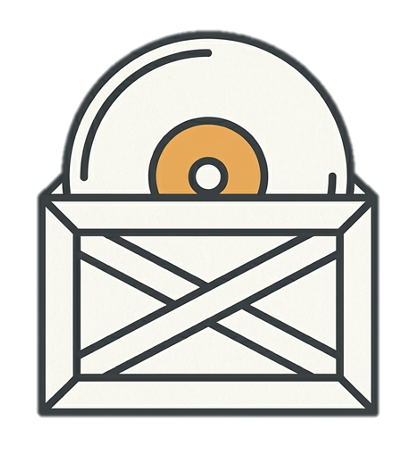

# Allocrate

Sort a DJ library into crates quickly. Allocrate shows one track at a time with a row of coloured crate buttons. Tap one and move on. When you finish, export the result back into rekordbox, or as plain folders.

**Live site:** https://allocrate.app

## Why it exists

Tagging and organising a big library is slow, and the usual tools ask for a lot of attention per track. Allocrate is built to be fast and low effort, which helps if you find long admin tasks hard to stay with.

## How it works

1. **Import** a rekordbox collection XML, or pick a folder of audio files.
2. **Sort** each track by tapping a crate. Skipped tracks come back round at the end.
3. **Export** an XML for rekordbox, or a zip of playlists and folders.

To get your collection out of rekordbox, use File, then Export Collection in xml format. Keep that file as a backup.

## The sorter

- Import a rekordbox XML, or a folder of audio files. For folders, artist, title, BPM, key and year are read from the file tags in your browser, with the filename as a fallback.
- One tap sorting, with skip and undo
- Multi-crate mode, so a track can go in more than one crate
- Preset crate groups (mood, timing, genre) that you can combine, plus custom crates with their own colours
- Live crate view that updates as you sort
- A "more info" toggle for BPM, key and year
- 30 second previews from Deezer where a track is available
- **Export xml:** adds an Allocrate folder of playlists to your original XML. Your existing collection and playlists are left alone. For folder imports it builds a fresh XML instead.
- **Export crates:** a zip with one .m3u8 playlist per crate, plus a script that builds real folders of symlinks. Nothing is copied or moved.

## IDEngine

A second tool for finding tracks you don't have yet. Take a photo of a tracklist, or paste a screenshot, and IDEngine reads the text in your browser. You can fix any OCR mistakes, then it splits the list into artist and song and gives you search links for YouTube, SoundCloud, Bandcamp and Spotify. It handles numbered lists, timestamps and `w/` mashup lines.

## Privacy

Your library is read and processed in your browser. Nothing is uploaded to a server, and images in IDEngine are never sent anywhere. A few things do touch the network:

- The preview button sends a track name and artist to Deezer to look up a clip.
- jsmediatags and Tesseract.js load from a CDN, and Tesseract downloads its OCR engine and language data the first time you use it.
- The IDEngine search links open the platform you pick in a new tab.

## Known limitations

- Progress is not saved yet. Closing the tab loses it.
- Browsers do not expose full file paths, so an XML exported from a folder import has relative locations and rekordbox may not relink those tracks. Use "export crates" or rekordbox's Relocate instead. XML imports are not affected.
- The folder script (`create-folders.sh`) works on macOS and Linux only.
- The help popup opens on hover, so it does not open on touch devices.
- Rekordbox XML only for now. Serato is not supported.

## Planned

- Save progress in the browser
- Keyboard shortcuts on the sort screen
- One library holding tracks you own and tracks you want, with IDEngine adding to it

## Running it locally

There is no build step. Download or clone the repo and open `index.html` in a browser. If previews or imports misbehave, serve the folder instead with `python3 -m http.server` and open http://localhost:8000.

## Built with

Plain HTML, CSS and JavaScript. No frameworks. Two libraries load from a CDN: jsmediatags for reading audio tags and Tesseract.js for OCR.

## Status

Early and still changing. Feedback and bug reports are welcome.

## Licence

MIT